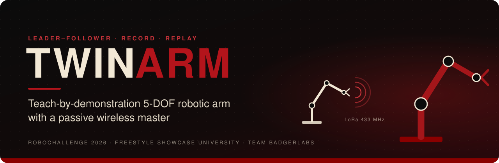
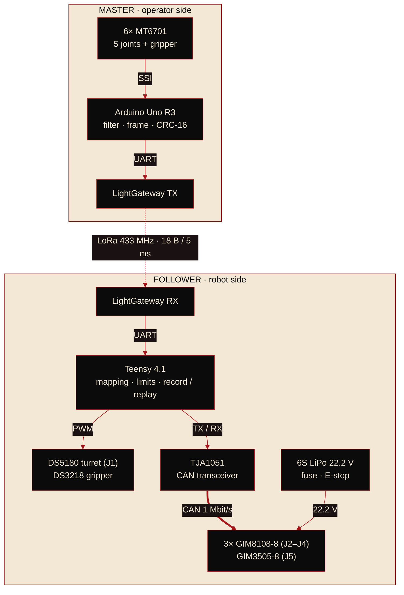
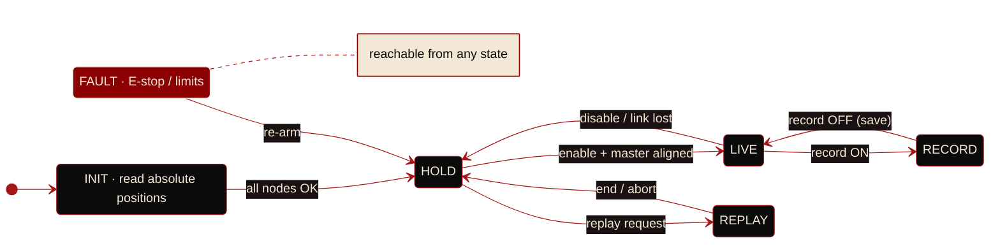
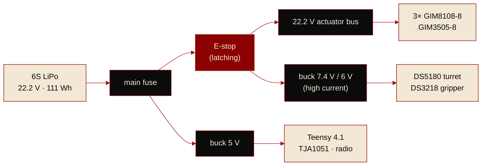
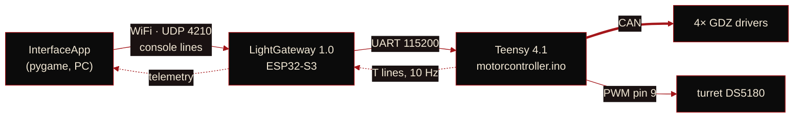

<p align="center">
  
</p>

<p align="center">
  
  
  
  
  
  
</p>

<p align="center">
  <b>Move a small, passive arm by hand. A high-torque arm copies you, wirelessly and in real time.<br>
  Record the motion, and it replays it on its own. No PC, no code.</b>
</p>

<p align="center">
  <a href="#overview">Overview</a> ·
  <a href="#how-it-works">How it works</a> ·
  <a href="#hardware">Hardware</a> ·
  <a href="#software">Software</a> ·
  <a href="#getting-started">Getting started</a> ·
  <a href="#roadmap">Roadmap</a> ·
  <a href="#team">Team</a>
</p>

<p align="center">
  <a href="Documentation/TwinArm___RoboChallenge.pdf"></a>
</p>

<div align="center">
<table>
  <tr>
    <td align="center" width="25%"><h3>5 + 1</h3><sub>DOF + gripper</sub></td>
    <td align="center" width="25%"><h3>≈ 13.9 ms</h3><sub>end-to-end latency</sub></td>
    <td align="center" width="25%"><h3>200 Hz</h3><sub>follower control rate</sub></td>
    <td align="center" width="25%"><h3>0.022°</h3><sub>master encoder resolution</sub></td>
  </tr>
</table>
</div>


## Overview

> **The problem.** How can a non-expert operator command a high-torque robotic arm in real time, intuitively and from a safe distance, and how can the demonstrated motion be stored and reproduced autonomously, without a PC and without writing code?

**TwinArm** is a 5-DOF + gripper leader–follower platform: base turret, shoulder, elbow, wrist pitch and wrist roll. The operator moves a light, **passive master arm** that is a scaled geometric copy of the robot. Contactless absolute magnetic encoders on every master joint are read by an Arduino Uno, and the joint angles travel over a **433 MHz LoRa link** to a **Teensy 4.1**, which drives four FOC brushless actuators over **CAN** (shoulder, elbow, wrist pitch, wrist roll) and two PWM servos (base turret, gripper). Every demonstration can be **recorded on board and replayed autonomously**, faster or slower, which is the first step towards learning from demonstration on embedded hardware.

> [!NOTE]
> **Project status.** The full system is designed in the [technical report](Documentation/TwinArm___RoboChallenge.pdf). This repository currently holds the follower-side bench firmware (CAN actuator driver, homing and jog console) and hardware unit tests. Values marked *estimate* will be verified on the prototype.

### Objectives

| | Objective | Design target |
|:-:|---|---|
| **O1** | **Intuitive command** | a passive, light, kinematically matched master moved by hand; the follower reproduces it joint by joint |
| **O2** | **Real-time mirroring** | end-to-end latency **< 20 ms**, steady-state joint tracking error **< 1°** |
| **O3** | **Wireless and robust** | untethered long-range LoRa (CSS) link, robust to narrowband interference, with supervised link-loss behaviour |
| **O4** | **Teach and replay** | on-board recording and autonomous, time-scalable replay, without an external computer |
| **O5** | **Safety by design** | joint, velocity and acceleration limits, link watchdog, hardware emergency stop |

### Why TwinArm

| Approach | Intuitiveness | Operator position | Recording | Limitation |
|---|---|---|---|---|
| Teach pendant / offline | low (waypoints, code) | next to robot / PC | waypoints | slow, trained staff |
| Hand guiding (cobots) | high | inside workspace | on controller | heavy arms, F/T sensing |
| Joystick, 3D mouse, VR | medium | remote | on PC | cognitive mapping |
| ALOHA / GELLO leader arms | high | close, wired | on PC | tethered, same scale |
| **TwinArm** | **high (1:1 joints)** | **remote, wireless** | **on MCU** | no force feedback yet |

TwinArm combines a **scaled** passive master, a **wireless** LoRa link, **industrial-style** FOC actuators and **on-board** recording and replay.


## How it works



### A teach-and-replay session

1. **Power on, release the E-stop.** The follower enters `INIT` and reads the absolute positions of all CAN actuators. Both arms use absolute encoders, so **no homing is needed**.
2. **Align and enable.** The *alignment interlock* allows `HOLD → LIVE` only when every master joint is close to the follower pose; status LEDs on the master show which joint still needs aligning, so mirroring never starts with a jump.
3. **Every 5 ms the master** reads its six encoders (five joints and the gripper trigger) over SSI, applies the harmonic calibration and a low-pass filter, and sends an **18-byte frame**: header, sequence number, mode, six 16-bit values (five joint angles and the gripper) and a CRC-16.
4. **The follower** checks CRC and sequence, resets the watchdog, maps master to follower, applies joint limits, a rate limiter and gravity feed-forward, and sends set-points. The **FOC position loop runs inside each actuator**.
5. **In `RECORD`**, the commanded trajectory $(t_k,\mathbf q_k)$ is stored at 100 Hz, about **72 kB per minute**.
6. **In `REPLAY`**, the stored trajectory is smoothed with a zero-phase filter, spline-interpolated and optionally time-scaled. Every move to a new pose without the master uses a **minimum-jerk** transition.

> [!IMPORTANT]
> **Link watchdog:** no valid frame for 50 ms puts the follower in `HOLD`. **Emergency stop:** the latching E-stop cuts actuator power and forces `FAULT`; the logic rail stays alive, logs the event and refuses to move again until the operator re-arms the system.

### Follower state machine



### Two ways to map the master

| Mode | How it works |
|---|---|
| **Joint space** (default) | each follower joint copies its master joint after an offset and direction calibration, $q^{*}_{f,i}=\sigma_i(\bar q_{m,i}-o_i)$. No inverse kinematics needed; the tool traces the master path magnified by $1/\kappa$ with identical orientation. |
| **Task space with motion scaling** | for fine work the motion is scaled by $s\in(0,1]$, e.g. $s=0.1$ turns 10 cm of hand motion into 1 cm and attenuates hand tremor by the same factor. Closed-form IK, with Damped Least Squares near singularities. |


## Hardware

### Main components

| Component | Role | Key parameters |
|---|---|---|
| **Teensy 4.1** | follower controller | i.MX RT1062 Cortex-M7 @ 600 MHz, 1 MB RAM, 8 MB flash, 3 CAN controllers, microSD |
| **3× SteadyWin GIM8108-8** | shoulder, elbow, wrist pitch (J2–J4) | integrated FOC driver (GDZ468), 8:1 planetary gear, 7.5 N·m rated / 22 N·m stall, CAN |
| **SteadyWin GIM3505-8 V1.1** | wrist roll (J5) | integrated FOC driver (GDS34), 8:1 planetary gear, 0.65 N·m rated / 1.27 N·m stall, 97 g, 12–40 V, CAN |
| **DS5180 servo** | base turret (J1) | 7.65 N·m at 7.4 V, 0.17 s/60°, PWM 500–2500 µs, 3 µs dead band |
| **DS3218 servo** | gripper | PWM, metal gears |
| **TJA1051** | CAN transceiver | ISO 11898-2 physical layer, up to 5 Mbit/s |
| **6× MT6701** | master encoders: five joints and the gripper trigger | Hall-based, 14-bit absolute, SSI / I²C, < 2 µs delay |
| **Arduino Uno R3** | master controller | ATmega328P @ 16 MHz; reads encoders, builds radio frames |
| **2× LightGateway 1.0** | radio link | ESP32-S3 + EBYTE E22-400M22S (SX1268), LoRa 433 MHz, up to 22 dBm |
| **6S LiPo 5000 mAh 50C** | follower power | 22.2 V nominal (25.2 V full), 111 Wh |

Each SteadyWin actuator integrates motor, FOC driver, gearbox and absolute encoder in one housing, so **every joint is a single CAN node**. The heavy GIM8108-8 units carry the shoulder, elbow and wrist pitch; the light GIM3505-8 turns the wrist roll, to keep mass, and therefore shoulder torque, low.

### Kinematic structure

The arm has five joints: a base turret (yaw), then shoulder, elbow and wrist pitch, which all pitch in one vertical plane, and a wrist roll about the tool axis, plus the gripper. The links are 300 mm (upper arm), 300 mm (forearm) and 142 mm (wrist pitch axis to the tool tip). The master is a geometric copy of the follower scaled by $\kappa<1$; uniform scaling leaves the joint angles unchanged, so both arms share the same joint variables $q_1\dots q_5$. Maximum horizontal reach from the shoulder axis is $a_2+a_3+d_5=$ **0.74 m**.

<div align="center">

| $i$ | joint | $a_i$ [mm] | $\alpha_i$ | $d_i$ [mm] | $\theta_i$ |
|:-:|:-:|:-:|:-:|:-:|:-:|
| 1 | turret | 0 | $\pi/2$ | $d_1$ | $q_1$ |
| 2 | shoulder | $a_2=300$ | 0 | 0 | $q_2$ |
| 3 | elbow | $a_3=300$ | 0 | 0 | $q_3$ |
| 4 | wrist pitch | 0 | $\pi/2$ | 0 | $q_4+\pi/2$ |
| 5 | wrist roll | 0 | 0 | $d_5=142$ | $q_5$ |

<sub>Denavit–Hartenberg parameters of the follower as built ($d_1$ = shoulder axis height; master lengths scaled by κ). The app and the Teensy measure joints from the idle pose found by homing instead.</sub>

</div>

### Power distribution



Separate rails keep actuator current peaks away from the logic. The logic rail is taken **before** the E-stop, so the controller stays alive to log the event. Autonomy is about **1.1 h** at an average 100 W. The master is powered separately (USB or a small battery) and carries no power electronics, so the operator only ever handles a low-voltage, passive device.


## Software

### Stack

| Tier | Tools and libraries | Purpose |
|---|---|---|
| **Follower firmware** | C++, Teensyduino / PlatformIO, FlexCAN_T4, PWMServo, SdFat | control loop, CAN actuator protocol, servo PWM, trajectory storage |
| **Master firmware** | C++, Arduino framework, SPI (SSI read-out) | encoder acquisition, filtering, framing with CRC |
| **Actuator configuration** | SteadyWin configuration tool (USB) | CAN IDs, limits, position-loop gains |
| **Design and analysis** | Autodesk Fusion, MATLAB / Python | mechanical design, kinematics, timing analysis |

### End-to-end latency budget

| Contribution | Model | Estimate |
|---|:-:|--:|
| Master sampling (mean) | $T_m/2$ | 2.5 ms |
| Encoder read-out | $6\cdot 24/f_\text{SSI}$ | 0.15 ms |
| UART to and from the radios | $2\cdot 10B/R_\text{UART}$ | 3.1 ms |
| Radio air time (LoRa SF5, 500 kHz, CR 4/5) | $t_\text{air}$ | ≈ 4.0 ms |
| Follower loop (mean) | $T_c/2$ | 2.5 ms |
| CAN commands | $5\,C(8)$ | 0.68 ms |
| Actuator update | $t_\text{act}$ | ≈ 1 ms |
| **Total** | | **≈ 13.9 ms** |

The stock LightGateway firmware (SF12, 125 kHz) would take about **1.3 s** per 18-byte frame, so both radios are reconfigured for the shortest air time: SF5 at 500 kHz. The resulting lag of 1.25° at 90°/s is cut to **0.035°** by an α–β tracker that also estimates joint velocity and sends it as feed-forward.

### Real-time scheduling on the Teensy

Fixed-priority, rate-monotonic tasks. The control task runs in a hardware-timer ISR; radio and CAN reception are interrupt-driven; SD logging runs in the background loop. Total utilisation is about **5.6 %**, far below the 75.7 % rate-monotonic bound, which leaves headroom for IK at the full control rate. The CAN bus runs at **200 Hz**, about 22 % load with one command and one reply per actuator.

| Task | Mechanism | $T_i$ | $C_i$ (estimate) |
|---|---|:-:|:-:|
| τ₁ control: mapping, limits, feed-forward, CAN commands | timer ISR | 5 ms | 150 µs |
| τ₂ radio frame: CRC, decode, watchdog | UART interrupt | 5 ms | 40 µs |
| τ₃ CAN replies: feedback, status | CAN interrupt | 5 ms | 50 µs |
| τ₄ logging: buffered SD writes | background loop | 100 ms | 800 µs |

### Design numbers

| Parameter | Value | Basis | | Parameter | Value | Basis |
|---|---|:-:|---|---|---|:-:|
| Degrees of freedom | 5 + gripper | design | | End-to-end latency | ≈ 13.9 ms | estimate |
| Master encoder resolution | 0.022° (14 bit) | design | | Link-loss detection | 50 ms | design |
| Base servo resolution | 0.27° | design | | False watchdog trip ($p$ = 1 %) | 10⁻²⁰ | estimate |
| Control / sampling rate | 200 Hz | design | | Recording memory | 72 kB/min | design |
| Joint torque rated / stall | 7.5 / 22 N·m | datasheet | | Steady-state tracking error | ≤ 0.58° | estimate |
| Payload at 0.74 m (static) | ≤ 1.0 kg | estimate | | Radio range (long-range mode) | 7 km | datasheet |
| Battery energy | 111 Wh (≈ 1.1 h) | estimate | | Teensy CPU utilisation | ≈ 5.6 % | estimate |
| Lag at 90°/s (raw / predicted) | 1.25° / 0.035° | estimate | | Phase-margin loss (in actuator) | ≈ 1.8° | estimate |

<details>
<summary><b>Key equations</b></summary>

<br>

**Forward kinematics**

```math
\mathbf{T}_0^5(\mathbf q)=\prod_{i=1}^{5}\mathbf A_i(q_i)
```

**Task-space target with motion scaling**

```math
\mathbf p_f^{*}=\mathbf p_f(t_0)+\frac{s}{\kappa}\big(\mathbf p_m-\mathbf p_m(t_0)\big),\qquad \mathbf R_f^{*}=\mathbf R_m
```

**Safety supervisor:** joint limits plus a velocity-bounded rate limiter, so even a command jump moves the follower at most $\omega_\text{max}T_c$ per cycle

```math
q^c_k=q^c_{k-1}+\operatorname{sat}_{\pm\omega_\text{max}T_c}\Big(\operatorname{clip}_{[q_\text{min},\,q_\text{max}]}(q^{*}_k)-q^c_{k-1}\Big)
```

**CAN bus load** at 1 Mbit/s

```math
U=N_f\,C(8)\,f_c=8\cdot 135\,\mu\text{s}\cdot 200\,\text{Hz}\approx 22\,\%
```

**Position loop by pole placement** (critically damped at the heaviest configuration, so a lighter arm is only slower, never oscillatory)

```math
K_p=J\omega_n^2,\qquad K_d=2\zeta\omega_n J-b,\qquad \omega_n=2\pi\cdot 5\,\text{Hz},\ \zeta=1
```

**Minimum-jerk transitions**

```math
q_i(t)=q_{i,0}+\Delta q_i\left(10\tau^3-15\tau^4+6\tau^5\right),\qquad \tau=t/T
```

**Maximum replay speed-up**, computed before execution so a replay never violates the limits

```math
\gamma_\text{max}=\min_i\,\min\left(\frac{\omega_{\text{max},i}}{\max_t|\dot q_i(t)|},\ \sqrt{\frac{\alpha_{\text{max},i}}{\max_t|\ddot q_i(t)|}}\right)
```

</details>


## Getting started

### Repository layout

```text
TwinArm/
├── ArduinoCode/
│   ├── libraries/
│   │   └── TwinLink/                     encrypted, frequency-hopping LoRa link shared by both gateways
│   ├── main_components/
│   │   ├── lightgateway/
│   │   │   └── lightgateway.ino          follower's LightGateway 1.0 (ESP32-S3): WiFi ↔ UART bridge + radio
│   │   ├── master_arm/
│   │   │   └── master_arm.ino            master's LightGateway: 4 MT6701 joints, roll pot, gripper button, radio, USB
│   │   └── slave_arm/
│   │       ├── motorcontroller/          follower firmware (Teensy 4.1)
│   │       │   ├── motorcontroller.ino     discovery, homing, serial jog console, gateway link
│   │       │   └── GDZ.h                   header-only SteadyWin GDZ CAN driver
│   │       └── motorcontroller_old/      previous iteration
│   └── unittests/
│       └── servotest/
│           └── servotest.ino             standalone gripper servo test
├── InterfaceApp/                         pygame wireless interface
│   ├── main.py                             the app
│   ├── link.py · arm.py · tune.py          WiFi / radio link, side-view kinematics, step-response tuning hints (each self-tests)
│   └── sim.py                              fake gateway + arm for trying the app without hardware
└── Documentation/
    ├── TwinArm___RoboChallenge.pdf       full technical report
    └── assets/                           README artwork
```

### Follower bench firmware: `motorcontroller`

On boot it runs the CAN decoder self-test, pings drivers **1–4** and prints firmware, voltage, temperature, gear ratio, torque constant and fault code for each one. It then opens and closes the gripper once, homes every joint to the **arm zero** (driver origin + `HOME_OFFSET`) and holds. Every 100 ms it prints each joint's angle relative to the arm zero, current, mode and fault code, and sends the same data to the LightGateway (see [Wireless interface](#wireless-interface-interfaceapp)).

**You need**

- a **Teensy 4.1** and the Arduino IDE with **Teensyduino**, which bundles `FlexCAN_T4` and `Servo`
- a **TJA1051** transceiver: Teensy pin **22 → TXD**, pin **23 ← RXD**; CANH/CANL terminated with **120 Ω at both ends**
- SteadyWin GDZ drivers on addresses **1–4**, CAN at **1 Mbit/s** (driver default, set in the ZE300 GUI)
- the gripper servo signal on pin **6** and the turret servo (DS5180) on pin **9**, each powered from its own supply, ground shared with the Teensy

**Flash it:** open `ArduinoCode/main_components/slave_arm/motorcontroller/motorcontroller.ino`, choose *Tools → Board → Teensy 4.1*, upload, then open the Serial Monitor with the *Newline* line ending.

**Serial console**

| Command | Action | Example |
|---|---|---|
| `x` | release all motors | `x` |
| `h` | home all: gripper open / close, then every joint to its arm zero | `h` |
| `d` | toggle raw CAN frame dump | `d` |
| `s` | toggle gripper sweep (stopping returns to idle) | `s` |
| `<id> a<deg>` | go to angle, relative to the arm zero | `1 a90` |
| `<id> r<deg>` | move relative to the current position | `1 r-30` |
| `<id> v<rpm>` | set max move speed | `1 v30` |
| `<id> h` | home one joint | `1 h` |
| `<id> o` | release one joint | `1 o` |
| `<id> c` | clear fault and jam, show the fault code left afterwards | `1 c` |
| `t <deg>` | turret angle, 0 = centre | `t -30` |
| `p <%>` | gripper position on its 1350–2000 µs scale, 0–100 % | `p 40` |
| `<id> g [pKp pKi vKp vKi]` | read the driver's position and velocity loop gains, or write all four then read them back | `1 g 20 0.5 8 0.1` |
| `<id> m<amps>` | max current of the driver | `1 m8` |
| `<id> s<deg>` | step test: move by `deg` from where it is, sample every 10 ms for 2 s, send the curve (blocks 2 s) | `1 s5` |
| `j [deg ms]` | read jam detection, or set its tolerance and time (`ms` 0 = off) | `j 4 400` |
| `rec` | record a take: the commanded joints, turret and gripper, 100 times a second, up to 5 min | `rec` |
| `stop` | end the recording (saved on the SD card as `TAKEnnn.BIN`) or the replay (the arm holds) | `stop` |
| `play <%>` | replay the loaded take at 10–200 % speed: a minimum-jerk move to its first pose, then the take, smoothed; a manual move or a jam stops it | `play 100` |
| `load <n>` / `takes` | load take *n* from the card / list the takes on it | `load 3` |

**Calibration knobs** at the top of the sketch

| Constant | Default | Meaning |
|---|---|---|
| `HOME_OFFSET[id]` | `{0, 0, 5, 0, 45}` | degrees from driver origin to arm zero, indexed by driver address |
| `HOME_RPM` | `10` | speed limit for the homing move (the driver forgets it at power-off) |
| `CAN_BAUD` | `1000000` | must match the CAN baud set in the ZE300 GUI |
| `GRIPPER_CLOSED_US` / `GRIPPER_OPEN_US` | `1350` / `2000` | hard limits: every gripper pulse is clamped to these |
| `TURRET_SPAN_DEG` | `180` | degrees the turret turns between the 500 µs and 2500 µs pulses |
| `TURRET_MIN_US` / `TURRET_MAX_US` | `500` / `2500` | hard limits for the turret pulse |
| `jamErrDeg` / `jamMs` | `4` / `400` | jam detection: further than this from the target, moving less than a quarter of what the speed limit allows, for this long; also set at run time with `j` |

**Jam detection.** Every telemetry sweep the Teensy checks each joint in position mode. A joint more than `jamErrDeg` from its target that moved less than a quarter of what its speed limit allows (and under 1° per sweep, so a joint that is slow but moving does not count), for `jamMs`, is jammed: it holds where it stopped instead of pushing on, ignores `a`/`r` until `<id> c` or homing, and reports it in telemetry. `jamMs` 0 turns it off.

> [!CAUTION]
> The follower is a high-torque arm. Keep the E-stop within reach and clear of the workspace; `x` releases all motors from the console.

### `GDZ.h`: CAN driver for SteadyWin GDZ actuators

A header-only driver for SteadyWin GDZ drivers (ZE300 firmware, custom CAN protocol v3.07) on one CAN bus. Each call sends one standard 11-bit frame and waits for the reply; decoded values land in `bus.m[id]`. Units are degrees, RPM and amperes.

```cpp
#include "GDZ.h"

GDZBus<CAN1> bus;                    // CAN1: pin 22 -> TJA1051 TXD, pin 23 <- RXD

void setup() {
  Serial.begin(115200);
  bus.begin(1000000);
  if (bus.ping(1)) bus.moveTo(1, 90);  // driver 1 to 90° (absolute, multi-turn)
}

void loop() {
  if (bus.readPosition(1)) Serial.println(bus.m[1].deg);
  delay(100);
}
```

| Group | Calls |
|---|---|
| **Read** | `ping` · `status` · `readPosition` · `readSpeed` · `readCurrent` · `readState` · `readMotorInfo` |
| **Control** | `current(A)` · `speed(rpm)` · `moveTo(deg)` · `moveBy(deg)` · `home` · `off` · `offAll` (broadcast) |
| **Settings** | `setMaxSpeed` · `setMaxCurrent` · `setCurrentSlope` · `setAccel` · `setZeroHere` · `clearFault` · `brake` · `setGain` / `getGain` · `reboot` |
| **MIT impedance** (fw ≥ 3026) | `readMitLimits` · `readMit` · `mit(pos, vel, kp, kd, torque)` |
| **Debug** | `bus.dump = true` prints every frame · `selfTest()` decodes the protocol PDF's example replies |

Settings are lost at power-off, except `setZeroHere`, which is saved in the driver.

### Gripper servo test: `servotest`

Type a pulse width in microseconds (for example `1500`) in the Serial Monitor and the servo on pin 6 goes there. Nothing else runs: no CAN, no homing. Input is clamped to 500–2500 µs; the gripper may bind well inside that range, which is why the follower firmware limits it to 1350–2000 µs.

### Wireless interface: `InterfaceApp`

A pygame app that drives and watches the follower over **WiFi**, through a LightGateway 1.0 mounted on the robot, or over the **LoRa radio**, through the master arm's LightGateway on USB (type its COM port in the Connection panel). The *LoRa Master* tab shows the master arm (four MT6701s: turret, shoulder, elbow, wrist pitch; the wrist-roll pot; the gripper button) and the radio link; Over the radio the master is the controller: no tip dragging or keys, the follower copies the master whenever Control is ON. Over WiFi the same happens with *Follow master* switched on. Either way the follower copies the master: each encoder's turn from the master's idle pose is the follower joint's angle from its arm zero (turret and joint limits and the table still apply), the roll pot turns the wrist roll and the button opens and closes the gripper. *Set idle from master* captures the idle pose (master in the same pose as the follower at its arm zero), a Normal / Inverted switch per joint sets the directions, and the Manual tab draws the master's pose in amber, to check them before Control ON.

**Teach & Replay** tab: with Control ON, *Record* makes the Teensy store what the follower is told; *Stop* (or Control OFF) saves the take on its SD card. *Play* turns Control OFF and lets the Teensy replay the loaded take by itself at the chosen speed, so a replay keeps going without the PC or the link; Control ON takes over again. The takes on the card are listed with a *Load* button each.

**Radio link** (`ArduinoCode/libraries/TwinLink`): the two gateways pair through a 16-byte key kept in each one's flash. Send `#key <32 hex digits>` to each gateway's USB serial, the same key on both (`python -c "import secrets; print(secrets.token_hex(16))"` makes one); `#key` alone prints a fingerprint to compare, `#test` runs the protocol self-test. Each connection starts with a challenge-response on that key (HMAC-SHA256, the key never goes on air) and a fresh AES-128 session key. Every frame is AES-GCM encrypted and authenticated, and hops to the next of 7 channels (433.3–434.5 MHz, SF5 / 500 kHz, 28 slots a second, `#hello` round trip 63–78 ms on the bench); a piece of a line that does not get through goes again in the next slot, on the next channel. Build both gateway sketches with RadioLib and this folder on the library path (`arduino-cli compile --libraries ArduinoCode/libraries …`, or copy `TwinLink` into the Arduino IDE sketchbook's `libraries`).



The gateway is a transparent bridge. Each datagram from the app holds ordinary console commands (`1 a12.50`, `t -30`, `x`) and goes to the Teensy unchanged. Each line the Teensy writes on its UART comes back as one datagram:

```text
T,id,ok,deg,target,amps,tempC,volts,busAmps,mode,fault,jammed   one per motor every 100 ms, angles relative to the arm zero
P,id,ok,posKp,posKi,velKp,velKi                                 answer to <id> g: the gains the driver holds
S,id,begin,start,target,10 · S,id,i,deg,deg… · S,id,end          answer to <id> s: the step test curve at 100 Hz, 10 samples a line
J,deg,ms                                                        answer to j: the jam detection in use
#hello <ms>  →  G,<ms>,<uptime ms>,<rssi dBm>               app ↔ gateway heartbeat, gives round trip and WiFi signal
#save <id> <pKp pKi vKp vKi>  →  B,id,<gains>             keep one driver's gains in the gateway's flash (NVS)
#load  →  B,id,<gains> … B,end,<count>                       read the gain backup back
```

**Wiring**

| LightGateway | Teensy 4.1 |
|---|---|
| TXD (IO18) | pin 7 (RX2) |
| RXD (IO17) | pin 8 (TX2) |
| GND | GND |

Both boards run at 3.3 V, so the wires go straight across; connect only these three, each board keeps its own power. Pin 9 is the turret servo, and only the hardware UART pins can receive. Once a second the gateway's USB serial prints how many datagrams it passed to the Teensy and how many lines came back: 0 lines back means TXD/RXD swapped, GND missing, or the Teensy still homing.

**Flash the gateway:** open `ArduinoCode/main_components/lightgateway/lightgateway.ino` with the Espressif *esp32* board package, board *ESP32S3 Dev Module*. By default it opens its own access point **TwinArm** (password in `AP_PASS`, change it) at `192.168.4.1:4210`; set `WIFI_SSID` / `WIFI_PASS` to join an existing network instead. The USB serial monitor prints the address at boot.

**Run the app**

```bash
pip install -r InterfaceApp/requirements.txt
```

```bash
python InterfaceApp/main.py
```

Join the TwinArm WiFi, open **Connection** (top left) and press *Connect*. With no hardware, run `python InterfaceApp/sim.py` in a second terminal and connect to `127.0.0.1`.

| Control | Action |
|---|---|
| **CONTROL** button | take control. The silhouette starts from the measured pose, so nothing jumps. When off, it idles and mirrors the telemetry |
| drag the red tip | the arm follows. Inverse kinematics for shoulder, elbow and wrist pitch: the closed-form solution on the elbow branch you are on, inside the joint limits. If the target is out of reach or past a limit, damped least squares moves to the nearest pose it can reach, letting the tool angle give way first (shown in amber). The arm never goes below the table |
| mouse wheel | tool (gripper) angle |
| `A` / `D` | turret left / right (open-loop servo, shown in the top-view dial) |
| `W` / `S` | wrist pitch up / down, on its own: shoulder and elbow stay, a later drag keeps the new wrist angle |
| `Q` / `E` | wrist roll left / right. The roll motor spins at *Wrist roll motor speed* (60°/s, not scaled by Speed %): its driver counts motor rpm before the 8:1 gear, so it is sent 60°/s = 10 rpm × 8 = 80 (*Roll driver rpm per output rpm* in Settings). The target leads the real roll by 15° at most, so it stops soon after the key is let go |
| `Space` / `Ctrl` (hold) | close (tighten) / open the gripper, gradually so it stops where you let go. Shown in the gauge under the turret dial and by the jaws in the drawing |
| **Speed** field, 1–100 % | type a value, then Enter or click away. Scales the joint speed (100 % = *Joint speed at 100 %* in Settings, 30 rpm by default) and the A/D rate; W/S and Q/E move at their joints' speed limit, so the target never runs ahead of the motor |
| **Idle** / `I` | back to the pose homing found (every joint to 0 from the arm zero the Teensy stored) and the turret centred, without homing again |
| `Esc` | control off; the arm holds its last target |
| Home all · Clear faults · Release motors | console `h`, `<id> c`, `x` (release asks for a second click: the arm falls). Clear faults turns into a red **Clear jam** while a joint is jammed |

Next to every joint the app shows its angle relative to the arm zero, target, temperature, driver power and current, mode and faults. On the right it graphs tracking error, phase current and temperature of every motor, one colour per joint. If telemetry stops for a second, Control switches off and the arm holds its pose. If the Teensy reports a jam, Control switches off too and will not come back on until the jam is cleared; the jammed joint pulses red in the drawing. In the simulator the elbow jams on a fake obstacle at +70°. The **Jam detection** switch (top right of the arm drawing, and in the Configuration tab) turns detection off and on; it shows what the Teensy reports, keeps the tolerance and time for switching back on, and does not release a joint that is already jammed (that still needs *Clear jam*). The Teensy starts with detection on after every reboot.

**Configuration tab** (sliders icon in the sidebar) tunes the drivers. Opening it reads every driver's position Kp/Ki and velocity Kp/Ki into a table; edit a value and it shows the driver's current value in amber until you press *Apply*, which writes the four gains and the max current and reads the gains back. *Read all* / *Apply all* do every motor; typed values are also saved in `settings.json`. Below it, the jam detection tolerance and time go to the Teensy. These are the drivers' own loop gains: the position and velocity loops run inside each SteadyWin driver (at 1 kHz, per SteadyWin), every move the Teensy sends is a position command (`0xC2`), and the Teensy only passes the gain values on.

**Gain backup on the LightGateway.** *Back up to gateway* stores what the drivers hold right now in the ESP32's flash (NVS, which survives power-off and re-uploading the sketch); overwriting an existing backup takes a second click. *Restore backup* loads it into the fields, *Apply all* writes it to the drivers. Back up once before experimenting: SteadyWin does not publish the factory gains, so that first backup is your only copy of them (SteadyWin's own Motor Wizard / ZE300 tool can also show them). Whether gains written over CAN survive a driver power cycle is not documented for this protocol; test it with *Read*, change one value, power-cycle, *Read*. SteadyWin's app manual advises keeping **Position Ki at 0** ("otherwise vibration may cause unstoppable damage"); the app flags a non-zero one in red.

On the right, the step buttons (±5°, ±15°) run a step test on the selected motor (click its row) with Control off, at the current Speed %. The Teensy records it every 10 ms for 2 s and the app plots the curve, measures overshoot, rise, settling and steady error, and suggests gain changes (`tune.py`): ringing or more than 25 % overshoot lowers Position Kp and raises Velocity Kp, 10–25 % raises Velocity Kp, a slow clean rise raises Position Kp, a steady error raises Velocity Ki, a rise capped by the speed limit is pointed out instead of blamed on the gains, and so is a joint that cruises far under its limit (the driver's own cap). Each suggestion shows the values, scaled from what the driver holds (`Velocity Kp 8 → 9.6`). *Use suggestions* writes them into the fields; check them, *Apply*, step again, and repeat until it says *Looks well tuned*. The simulator models each joint from its position and velocity Kp, so this loop can be tried there: from 61 % overshoot it reaches 5 % in six rounds.

**Whole arm** runs the step test on every CAN joint, +5° then −5° so each ends where it started (about 20 s, Control off), shows a results table in the Configuration tab and saves two files in `InterfaceApp/step_tests/`: `steptest_<time>.csv` (one row per step: overshoot, rise, settling, steady error, peak speed and limit, the driver's four gains, verdict) and `steptest_<time>_curves.csv` (every 10 ms sample). The button (also *Run whole-arm test* under the jam settings, with *Open folder*) turns into *Stop* while it runs. After each step the app fits the simulator's joint model to the curve (natural frequency ωn, damping ζ, top speed) and saves it as `steptest_<time>_model.json` and `model_fit.json`.

**Comparing the real arm with the simulator** (`InterfaceApp/compare.py`, needs `matplotlib` for the plot):

```bash
python InterfaceApp/compare.py InterfaceApp/step_tests/steptest_A.csv InterfaceApp/step_tests/steptest_B.csv
```

prints overshoot, rise, settling, steady error and the fitted ωn / ζ / top speed of every step of A next to B, writes `steptest_A_compare.png` (both curves and the fitted model per joint and direction) and `model_fit.json`. `python InterfaceApp/sim.py --model InterfaceApp/step_tests/model_fit.json` then makes the simulator move like the fitted arm, starting with the gains it was measured with; changing gains scales the fit like a cascaded position → velocity loop (kp ∝ pos Kp · vel Kp, kv ∝ vel Kp), an approximation for trying a direction before the real arm.

**Settings** (top right, saved to `InterfaceApp/settings.json`) hold the calibration the drawing needs: link lengths (300 / 300 / 142 mm), the drawn angles of the idle pose at the arm zero, each motor's direction, joint and turret limits, speeds and graph window. Shoulder, wrist pitch and wrist roll default to *Inverted* and the elbow to *Normal*, which is how they turn on the real arm; the gripper is *Inverted* too, because on the real one the 1350 µs end opens it. Check each joint with a small move before dragging far.


## Roadmap

**In this repository**

- [x] `GDZ.h` CAN driver with decoder self-test
- [x] Follower bench firmware: discovery, homing to arm zero, serial jog console, live telemetry
- [x] Gripper servo bench test
- [x] WiFi interface: LightGateway bridge, pygame app with tip dragging, turret control, live telemetry and graphs

**Designed in the report, next to build**

- [x] Master firmware on a LightGateway: 4 MT6701 over I2C through a TCA9548A, wrist-roll pot, gripper toggle button, joint-space mapping from a captured idle pose
- [ ] Master refinements: harmonic calibration look-up table, α–β tracker, mapping on the follower instead of the app
- [x] LoRa link at SF5 / 500 kHz, encrypted and frequency-hopping, with a 500 ms link watchdog
- [ ] Follower state machine: `INIT` · `HOLD` · `LIVE` · `RECORD` · `REPLAY` · `FAULT`
- [x] microSD recording, time-scaled replay and minimum-jerk transitions on the Teensy, driven from the app's Teach & Replay tab
- [ ] Task-space mode with motion scaling and Damped Least Squares near singularities

**Future improvements**

- [ ] A CAN actuator on the base turret, removing the 0.27° resolution bottleneck and adding feedback on J1
- [ ] Haptic feedback on the master, rendering contact forces estimated from actuator currents (bilateral, passivity-based control)
- [ ] Learning-based autonomy: train ACT or Diffusion Policy on the recorded demonstrations, with a camera on the follower
- [ ] Quick-change end effectors (parallel gripper, vacuum) identified automatically by the controller


## Team

<div align="center">

**Team BadgerLabs** · National University of Science and Technology POLITEHNICA Bucharest × PRECIS Research Institute

<table>
  <tr>
    <td align="center" width="25%"><b>Matei Sebastian-Alexandru</b><br><sub>Team member<br>Year IV B.Sc., Faculty of Engineering in Foreign Languages</sub></td>
    <td align="center" width="25%"><b>Pletea-Marinescu Valentin</b><br><sub>Team member<br>Year I M.Sc., Advanced Control and Real-Time Systems, Faculty of Automatic Control and Computers</sub></td>
    <td align="center" width="25%"><b>Motrun Florin-Cristian</b><br><sub>Team member</sub></td>
    <td align="center" width="25%"><b>Prof. Univ. Lupu Ciprian-Gabriel</b><br><sub>Coordinator</sub></td>
  </tr>
</table>

<sub>RoboChallenge 2026 · Freestyle Showcase University</sub>

</div>

<details>
<summary><b>References</b></summary>

<br>

1. A. Correia, L. A. Alexandre, "A Survey of Demonstration Learning", *Robotics and Autonomous Systems*, 2024, doi:10.1016/j.robot.2024.104812
2. ISO 10218-1:2025, *Robotics: Safety requirements, Part 1: Industrial robots*, ISO, 2025
3. T. Z. Zhao, V. Kumar, S. Levine, C. Finn, "Learning Fine-Grained Bimanual Manipulation with Low-Cost Hardware", *RSS*, 2023
4. Z. Fu, T. Z. Zhao, C. Finn, "Mobile ALOHA: Learning Bimanual Mobile Manipulation using Low-Cost Whole-Body Teleoperation", *CoRL*, PMLR vol. 270, 2024
5. P. Wu, Y. Shentu, Z. Yi, X. Lin, P. Abbeel, "GELLO: A General, Low-Cost, and Intuitive Teleoperation Framework for Robot Manipulators", *IROS*, 2024
6. C. Chi et al., "Diffusion Policy: Visuomotor Policy Learning via Action Diffusion", *IJRR*, 2024, doi:10.1177/02783649241273668
7. J. Bolarinwa et al., "Haptic Teleoperation goes Wireless: Evaluation and Benchmarking of a High-Performance Low-Power Wireless Control Technology", *IEEE SSRR*, 2022
8. PJRC, [Teensy 4.1 Development Board](https://www.pjrc.com/store/teensy41.html)
9. SteadyWin, [GIM8108-8 planetary reducer servo motor](https://openelab.com/products/steadywin-gim8108-8-gearmotor-robotics)
10. SteadyWin, [GIM3505-8 robot gear motor](https://openelab.com/products/steadywin-gim3505-8-robot-gear)
11. DSSERVO, [DS5180 80 kg digital servo](https://rcdrone.top/products/dsservo-ds5180-80kg-servo)
12. NXP, [TJA1051 high-speed CAN transceiver datasheet](https://www.nxp.com/docs/en/data-sheet/TJA1051.pdf)
13. MagnTek, [MT6701 angle position sensor datasheet](https://voltiq.ru/datasheets/MT6701.pdf)
14. LightAPRS, [LightGateway 1.0: ESP32-based SX1268 LoRa (433 MHz) board](https://github.com/lightaprs/LightGateway-1.0)
15. EBYTE, [E22-400M22S SX1268 LoRa module](https://www.cdebyte.com/products/E22-400M22S)
16. Semtech, [SX1268 sub-GHz RF transceiver](https://www.semtech.com/products/wireless-rf/lora-connect/sx1268)
17. P. Corke, *Robotics, Vision and Control: Fundamental Algorithms in Python*, 3rd ed., Springer, 2023
18. ISO 11898-1:2024, *Road vehicles: Controller area network (CAN), Part 1*, ISO, 2024
19. A. Mueller, "Analytically Informed Inverse Kinematics Solution at Singularities", *ARK 2024*, Springer, 2024
20. ODrive Robotics, [CAN Protocol (CANSimple)](https://docs.odriverobotics.com/v/latest/manual/can-protocol.html)
21. L. Scalera, G. Fabris, P. Boscariol, A. Gasparetto, "Minimum-Jerk Trajectory Planning in Robotic Manipulators With Kinematic Redundancy", *J. Mechanisms and Robotics*, 2026
22. V. Pollex, F. Slomka, "A Mathematical Comparison Between Response-Time Analysis and Real-Time Calculus for Fixed-Priority Preemptive Scheduling", *ECRTS*, LIPIcs vol. 231, 2022
23. H. Singh et al., "Passivity Control with Energy Reflection and Haptic Data Reduction for Delayed Robust Bilateral Teleoperation", *IEEE SMC*, 2023

</details>

<br>


<p align="center"><sub>Built by <b>Team BadgerLabs</b> for RoboChallenge 2026</sub></p>
