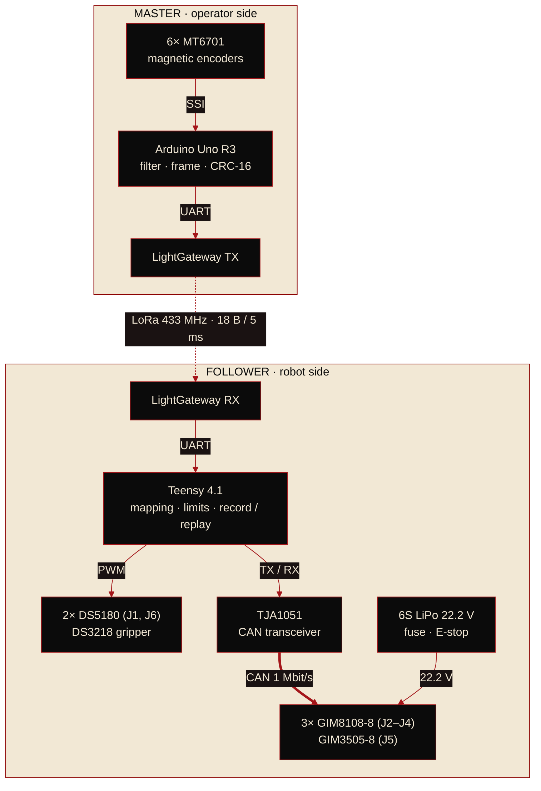
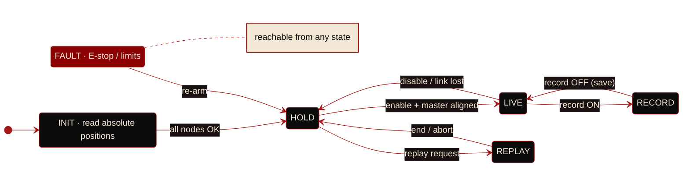
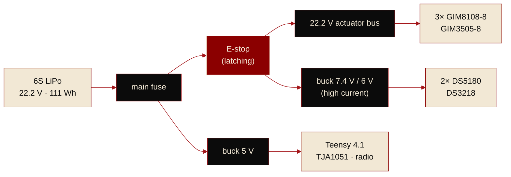

<p align="center">
  
</p>

<p align="center">
  
  
  
  
  
  
</p>

<p align="center">
  <b>Move a small, passive arm by hand. A high-torque arm copies you, wirelessly and in real time.<br>
  Record the motion, and it replays it on its own. No PC, no code.</b>
</p>

<p align="center">
  <a href="#overview">Overview</a> ·
  <a href="#how-it-works">How it works</a> ·
  <a href="#hardware">Hardware</a> ·
  <a href="#software">Software</a> ·
  <a href="#getting-started">Getting started</a> ·
  <a href="#roadmap">Roadmap</a> ·
  <a href="#team">Team</a>
</p>

<p align="center">
  <a href="Documentation/TwinArm___RoboChallenge.pdf"></a>
</p>

<div align="center">
<table>
  <tr>
    <td align="center" width="25%"><h3>6 + 1</h3><sub>DOF + gripper</sub></td>
    <td align="center" width="25%"><h3>≈ 13.9 ms</h3><sub>end-to-end latency</sub></td>
    <td align="center" width="25%"><h3>200 Hz</h3><sub>follower control rate</sub></td>
    <td align="center" width="25%"><h3>0.022°</h3><sub>master encoder resolution</sub></td>
  </tr>
</table>
</div>


## Overview

> **The problem.** How can a non-expert operator command a high-torque robotic arm in real time, intuitively and from a safe distance, and how can the demonstrated motion be stored and reproduced autonomously, without a PC and without writing code?

**TwinArm** is a 6-DOF leader–follower platform. The operator moves a light, **passive master arm** that is a scaled geometric copy of the robot. Contactless absolute magnetic encoders on every master joint are read by an Arduino Uno, and the joint angles travel over a **433 MHz LoRa link** to a **Teensy 4.1**, which drives four FOC brushless actuators over **CAN** and three PWM servos (base, wrist roll, gripper). Every demonstration can be **recorded on board and replayed autonomously**, faster or slower, which is the first step towards learning from demonstration on embedded hardware.

> [!NOTE]
> **Project status.** The full system is designed in the [technical report](Documentation/TwinArm___RoboChallenge.pdf). This repository currently holds the follower-side bench firmware (CAN actuator driver, homing and jog console) and hardware unit tests. Values marked *estimate* will be verified on the prototype.

### Objectives

| | Objective | Design target |
|:-:|---|---|
| **O1** | **Intuitive command** | a passive, light, kinematically matched master moved by hand; the follower reproduces it joint by joint |
| **O2** | **Real-time mirroring** | end-to-end latency **< 20 ms**, steady-state joint tracking error **< 1°** |
| **O3** | **Wireless and robust** | untethered long-range LoRa (CSS) link, robust to narrowband interference, with supervised link-loss behaviour |
| **O4** | **Teach and replay** | on-board recording and autonomous, time-scalable replay, without an external computer |
| **O5** | **Safety by design** | joint, velocity and acceleration limits, link watchdog, hardware emergency stop |

### Why TwinArm

| Approach | Intuitiveness | Operator position | Recording | Limitation |
|---|---|---|---|---|
| Teach pendant / offline | low (waypoints, code) | next to robot / PC | waypoints | slow, trained staff |
| Hand guiding (cobots) | high | inside workspace | on controller | heavy arms, F/T sensing |
| Joystick, 3D mouse, VR | medium | remote | on PC | cognitive mapping |
| ALOHA / GELLO leader arms | high | close, wired | on PC | tethered, same scale |
| **TwinArm** | **high (1:1 joints)** | **remote, wireless** | **on MCU** | no force feedback yet |

TwinArm combines a **scaled** passive master, a **wireless** LoRa link, **industrial-style** FOC actuators and **on-board** recording and replay.


## How it works



### A teach-and-replay session

1. **Power on, release the E-stop.** The follower enters `INIT` and reads the absolute positions of all CAN actuators. Both arms use absolute encoders, so **no homing is needed**.
2. **Align and enable.** The *alignment interlock* allows `HOLD → LIVE` only when every master joint is close to the follower pose; status LEDs on the master show which joint still needs aligning, so mirroring never starts with a jump.
3. **Every 5 ms the master** reads its six encoders over SSI, applies the harmonic calibration and a low-pass filter, and sends an **18-byte frame**: header, sequence number, mode, six 16-bit angles and a CRC-16.
4. **The follower** checks CRC and sequence, resets the watchdog, maps master to follower, applies joint limits, a rate limiter and gravity feed-forward, and sends set-points. The **FOC position loop runs inside each actuator**.
5. **In `RECORD`**, the commanded trajectory $(t_k,\mathbf q_k)$ is stored at 100 Hz, about **72 kB per minute**.
6. **In `REPLAY`**, the stored trajectory is smoothed with a zero-phase filter, spline-interpolated and optionally time-scaled. Every move to a new pose without the master uses a **minimum-jerk** transition.

> [!IMPORTANT]
> **Link watchdog:** no valid frame for 50 ms puts the follower in `HOLD`. **Emergency stop:** the latching E-stop cuts actuator power and forces `FAULT`; the logic rail stays alive, logs the event and refuses to move again until the operator re-arms the system.

### Follower state machine



### Two ways to map the master

| Mode | How it works |
|---|---|
| **Joint space** (default) | each follower joint copies its master joint after an offset and direction calibration, $q^{*}_{f,i}=\sigma_i(\bar q_{m,i}-o_i)$. No inverse kinematics needed; the tool traces the master path magnified by $1/\kappa$ with identical orientation. |
| **Task space with motion scaling** | for fine work the motion is scaled by $s\in(0,1]$, e.g. $s=0.1$ turns 10 cm of hand motion into 1 cm and attenuates hand tremor by the same factor. Closed-form IK, with Damped Least Squares near singularities. |


## Hardware

### Main components

| Component | Role | Key parameters |
|---|---|---|
| **Teensy 4.1** | follower controller | i.MX RT1062 Cortex-M7 @ 600 MHz, 1 MB RAM, 8 MB flash, 3 CAN controllers, microSD |
| **3× SteadyWin GIM8108-8** | follower joints 2–4 | integrated FOC driver (GDZ468), 8:1 planetary gear, 7.5 N·m rated / 22 N·m stall, CAN |
| **SteadyWin GIM3505-8 V1.1** | follower joint 5 | integrated FOC driver (GDS34), 8:1 planetary gear, 0.65 N·m rated / 1.27 N·m stall, 97 g, 12–40 V, CAN |
| **2× DS5180 servo** | base (J1), wrist roll (J6) | 7.65 N·m at 7.4 V, 0.17 s/60°, PWM 500–2500 µs, 3 µs dead band |
| **DS3218 servo** | gripper | PWM, metal gears |
| **TJA1051** | CAN transceiver | ISO 11898-2 physical layer, up to 5 Mbit/s |
| **6× MT6701** | master joint encoders | Hall-based, 14-bit absolute, SSI / I²C, < 2 µs delay |
| **Arduino Uno R3** | master controller | ATmega328P @ 16 MHz; reads encoders, builds radio frames |
| **2× LightGateway 1.0** | radio link | ESP32-S3 + EBYTE E22-400M22S (SX1268), LoRa 433 MHz, up to 22 dBm |
| **6S LiPo 5000 mAh 50C** | follower power | 22.2 V nominal (25.2 V full), 111 Wh |

Each SteadyWin actuator integrates motor, FOC driver, gearbox and absolute encoder in one housing, so **every joint is a single CAN node**. The heavy GIM8108-8 units carry the shoulder, elbow and first wrist joint; the light GIM3505-8 moves the second wrist joint to keep mass, and therefore shoulder torque, low.

### Kinematic structure

Both arms share an anthropomorphic 6-DOF structure with a spherical wrist. The master is a geometric copy of the follower scaled by $\kappa<1$; uniform scaling leaves the joint angles unchanged, so both arms share the same joint variables $q_1\dots q_6$. Maximum horizontal reach from the shoulder axis is $a_2+d_4+d_6=$ **0.55 m**.

<div align="center">

| $i$ | $a_i$ [mm] | $\alpha_i$ | $d_i$ [mm] | $\theta_i$ |
|:-:|:-:|:-:|:-:|:-:|
| 1 | 0 | $\pi/2$ | $d_1=300$ | $q_1$ |
| 2 | $a_2=300$ | 0 | 0 | $q_2$ |
| 3 | 0 | $\pi/2$ | 0 | $q_3$ |
| 4 | 0 | $-\pi/2$ | $d_4=150$ | $q_4$ |
| 5 | 0 | $\pi/2$ | 0 | $q_5$ |
| 6 | 0 | 0 | $d_6=100$ | $q_6$ |

<sub>Denavit–Hartenberg parameters of the follower (master lengths scaled by κ)</sub>

</div>

### Power distribution



Separate rails keep actuator current peaks away from the logic. The logic rail is taken **before** the E-stop, so the controller stays alive to log the event. Autonomy is about **1.1 h** at an average 100 W. The master is powered separately (USB or a small battery) and carries no power electronics, so the operator only ever handles a low-voltage, passive device.


## Software

### Stack

| Tier | Tools and libraries | Purpose |
|---|---|---|
| **Follower firmware** | C++, Teensyduino / PlatformIO, FlexCAN_T4, PWMServo, SdFat | control loop, CAN actuator protocol, servo PWM, trajectory storage |
| **Master firmware** | C++, Arduino framework, SPI (SSI read-out) | encoder acquisition, filtering, framing with CRC |
| **Actuator configuration** | SteadyWin configuration tool (USB) | CAN IDs, limits, position-loop gains |
| **Design and analysis** | Autodesk Fusion, MATLAB / Python | mechanical design, kinematics, timing analysis |

### End-to-end latency budget

| Contribution | Model | Estimate |
|---|:-:|--:|
| Master sampling (mean) | $T_m/2$ | 2.5 ms |
| Encoder read-out | $6\cdot 24/f_\text{SSI}$ | 0.15 ms |
| UART to and from the radios | $2\cdot 10B/R_\text{UART}$ | 3.1 ms |
| Radio air time (LoRa SF5, 500 kHz, CR 4/5) | $t_\text{air}$ | ≈ 4.0 ms |
| Follower loop (mean) | $T_c/2$ | 2.5 ms |
| CAN commands | $5\,C(8)$ | 0.68 ms |
| Actuator update | $t_\text{act}$ | ≈ 1 ms |
| **Total** | | **≈ 13.9 ms** |

The stock LightGateway firmware (SF12, 125 kHz) would take about **1.3 s** per 18-byte frame, so both radios are reconfigured for the shortest air time: SF5 at 500 kHz. The resulting lag of 1.25° at 90°/s is cut to **0.035°** by an α–β tracker that also estimates joint velocity and sends it as feed-forward.

### Real-time scheduling on the Teensy

Fixed-priority, rate-monotonic tasks. The control task runs in a hardware-timer ISR; radio and CAN reception are interrupt-driven; SD logging runs in the background loop. Total utilisation is about **5.6 %**, far below the 75.7 % rate-monotonic bound, which leaves headroom for IK at the full control rate. The CAN bus runs at **200 Hz**, about 22 % load with one command and one reply per actuator.

| Task | Mechanism | $T_i$ | $C_i$ (estimate) |
|---|---|:-:|:-:|
| τ₁ control: mapping, limits, feed-forward, CAN commands | timer ISR | 5 ms | 150 µs |
| τ₂ radio frame: CRC, decode, watchdog | UART interrupt | 5 ms | 40 µs |
| τ₃ CAN replies: feedback, status | CAN interrupt | 5 ms | 50 µs |
| τ₄ logging: buffered SD writes | background loop | 100 ms | 800 µs |

### Design numbers

| Parameter | Value | Basis | | Parameter | Value | Basis |
|---|---|:-:|---|---|---|:-:|
| Degrees of freedom | 6 + gripper | design | | End-to-end latency | ≈ 13.9 ms | estimate |
| Master encoder resolution | 0.022° (14 bit) | design | | Link-loss detection | 50 ms | design |
| Base servo resolution | 0.27° | design | | False watchdog trip ($p$ = 1 %) | 10⁻²⁰ | estimate |
| Control / sampling rate | 200 Hz | design | | Recording memory | 72 kB/min | design |
| Joint torque rated / stall | 7.5 / 22 N·m | datasheet | | Steady-state tracking error | ≤ 0.58° | estimate |
| Payload at 0.55 m (static) | ≤ 1.4 kg | estimate | | Radio range (long-range mode) | 7 km | datasheet |
| Battery energy | 111 Wh (≈ 1.1 h) | estimate | | Teensy CPU utilisation | ≈ 5.6 % | estimate |
| Lag at 90°/s (raw / predicted) | 1.25° / 0.035° | estimate | | Phase-margin loss (in actuator) | ≈ 1.8° | estimate |

<details>
<summary><b>Key equations</b></summary>

<br>

**Forward kinematics**

```math
\mathbf{T}_0^6(\mathbf q)=\prod_{i=1}^{6}\mathbf A_i(q_i)
```

**Task-space target with motion scaling**

```math
\mathbf p_f^{*}=\mathbf p_f(t_0)+\frac{s}{\kappa}\big(\mathbf p_m-\mathbf p_m(t_0)\big),\qquad \mathbf R_f^{*}=\mathbf R_m
```

**Safety supervisor:** joint limits plus a velocity-bounded rate limiter, so even a command jump moves the follower at most $\omega_\text{max}T_c$ per cycle

```math
q^c_k=q^c_{k-1}+\operatorname{sat}_{\pm\omega_\text{max}T_c}\Big(\operatorname{clip}_{[q_\text{min},\,q_\text{max}]}(q^{*}_k)-q^c_{k-1}\Big)
```

**CAN bus load** at 1 Mbit/s

```math
U=N_f\,C(8)\,f_c=8\cdot 135\,\mu\text{s}\cdot 200\,\text{Hz}\approx 22\,\%
```

**Position loop by pole placement** (critically damped at the heaviest configuration, so a lighter arm is only slower, never oscillatory)

```math
K_p=J\omega_n^2,\qquad K_d=2\zeta\omega_n J-b,\qquad \omega_n=2\pi\cdot 5\,\text{Hz},\ \zeta=1
```

**Minimum-jerk transitions**

```math
q_i(t)=q_{i,0}+\Delta q_i\left(10\tau^3-15\tau^4+6\tau^5\right),\qquad \tau=t/T
```

**Maximum replay speed-up**, computed before execution so a replay never violates the limits

```math
\gamma_\text{max}=\min_i\,\min\left(\frac{\omega_{\text{max},i}}{\max_t|\dot q_i(t)|},\ \sqrt{\frac{\alpha_{\text{max},i}}{\max_t|\ddot q_i(t)|}}\right)
```

</details>


## Getting started

### Repository layout

```text
TwinArm/
├── ArduinoCode/
│   ├── main_components/
│   │   └── slave_arm/
│   │       ├── motorcontroller/          follower bench firmware (Teensy 4.1)
│   │       │   ├── motorcontroller.ino     discovery, homing, serial jog console
│   │       │   └── GDZ.h                   header-only SteadyWin GDZ CAN driver
│   │       └── motorcontroller_old/      previous iteration
│   └── unittests/
│       └── servotest/
│           └── servotest.ino             standalone gripper servo test
└── Documentation/
    ├── TwinArm___RoboChallenge.pdf       full technical report
    └── assets/                           README artwork
```

### Follower bench firmware: `motorcontroller`

On boot it runs the CAN decoder self-test, pings drivers **1–4** and prints firmware, voltage, temperature, gear ratio, torque constant and fault code for each one. It then opens and closes the gripper once, homes every joint to the **arm zero** (driver origin + `HOME_OFFSET`) and holds. Every 200 ms it prints each joint's angle relative to the arm zero, current, mode and fault code.

**You need**

- a **Teensy 4.1** and the Arduino IDE with **Teensyduino**, which bundles `FlexCAN_T4` and `Servo`
- a **TJA1051** transceiver: Teensy pin **22 → TXD**, pin **23 ← RXD**; CANH/CANL terminated with **120 Ω at both ends**
- SteadyWin GDZ drivers on addresses **1–4**, CAN at **1 Mbit/s** (driver default, set in the ZE300 GUI)
- the gripper servo signal on pin **6**, powered from its own supply, ground shared with the Teensy

**Flash it:** open `ArduinoCode/main_components/slave_arm/motorcontroller/motorcontroller.ino`, choose *Tools → Board → Teensy 4.1*, upload, then open the Serial Monitor with the *Newline* line ending.

**Serial console**

| Command | Action | Example |
|---|---|---|
| `x` | release all motors | `x` |
| `h` | home all: gripper open / close, then every joint to its arm zero | `h` |
| `d` | toggle raw CAN frame dump | `d` |
| `s` | toggle gripper sweep (stopping returns to idle) | `s` |
| `<id> a<deg>` | go to angle, relative to the arm zero | `1 a90` |
| `<id> r<deg>` | move relative to the current position | `1 r-30` |
| `<id> v<rpm>` | set max move speed | `1 v30` |
| `<id> h` | home one joint | `1 h` |
| `<id> o` | release one joint | `1 o` |
| `<id> c` | clear fault and show the fault code left afterwards | `1 c` |

**Calibration knobs** at the top of the sketch

| Constant | Default | Meaning |
|---|---|---|
| `HOME_OFFSET[id]` | `{0, 0, 5, 0, 45}` | degrees from driver origin to arm zero, indexed by driver address |
| `HOME_RPM` | `10` | speed limit for the homing move (the driver forgets it at power-off) |
| `CAN_BAUD` | `1000000` | must match the CAN baud set in the ZE300 GUI |
| `GRIPPER_CLOSED_US` / `GRIPPER_OPEN_US` | `1350` / `2000` | hard limits: every gripper pulse is clamped to these |

> [!CAUTION]
> The follower is a high-torque arm. Keep the E-stop within reach and clear of the workspace; `x` releases all motors from the console.

### `GDZ.h`: CAN driver for SteadyWin GDZ actuators

A header-only driver for SteadyWin GDZ drivers (ZE300 firmware, custom CAN protocol v3.07) on one CAN bus. Each call sends one standard 11-bit frame and waits for the reply; decoded values land in `bus.m[id]`. Units are degrees, RPM and amperes.

```cpp
#include "GDZ.h"

GDZBus<CAN1> bus;                    // CAN1: pin 22 -> TJA1051 TXD, pin 23 <- RXD

void setup() {
  Serial.begin(115200);
  bus.begin(1000000);
  if (bus.ping(1)) bus.moveTo(1, 90);  // driver 1 to 90° (absolute, multi-turn)
}

void loop() {
  if (bus.readPosition(1)) Serial.println(bus.m[1].deg);
  delay(100);
}
```

| Group | Calls |
|---|---|
| **Read** | `ping` · `status` · `readPosition` · `readSpeed` · `readCurrent` · `readState` · `readMotorInfo` |
| **Control** | `current(A)` · `speed(rpm)` · `moveTo(deg)` · `moveBy(deg)` · `home` · `off` · `offAll` (broadcast) |
| **Settings** | `setMaxSpeed` · `setMaxCurrent` · `setCurrentSlope` · `setAccel` · `setZeroHere` · `clearFault` · `brake` · `setGain` / `getGain` · `reboot` |
| **MIT impedance** (fw ≥ 3026) | `readMitLimits` · `readMit` · `mit(pos, vel, kp, kd, torque)` |
| **Debug** | `bus.dump = true` prints every frame · `selfTest()` decodes the protocol PDF's example replies |

Settings are lost at power-off, except `setZeroHere`, which is saved in the driver.

### Gripper servo test: `servotest`

Type a pulse width in microseconds (for example `1500`) in the Serial Monitor and the servo on pin 6 goes there. Nothing else runs: no CAN, no homing. Input is clamped to 500–2500 µs; the gripper may bind well inside that range, which is why the follower firmware limits it to 1350–2000 µs.


## Roadmap

**In this repository**

- [x] `GDZ.h` CAN driver with decoder self-test
- [x] Follower bench firmware: discovery, homing to arm zero, serial jog console, live telemetry
- [x] Gripper servo bench test

**Designed in the report, next to build**

- [ ] Master firmware: SSI encoder read-out, harmonic calibration look-up table, α–β tracker, 18-byte CRC-16 frames
- [ ] LoRa link at SF5 / 500 kHz with the 50 ms watchdog
- [ ] Follower state machine: `INIT` · `HOLD` · `LIVE` · `RECORD` · `REPLAY` · `FAULT`
- [ ] microSD recording, time-scaled replay and minimum-jerk transitions
- [ ] Task-space mode with motion scaling and Damped Least Squares near singularities

**Future improvements**

- [ ] CAN actuators on the base and wrist roll, removing the 0.27° resolution bottleneck and adding feedback on J1 and J6
- [ ] Haptic feedback on the master, rendering contact forces estimated from actuator currents (bilateral, passivity-based control)
- [ ] Learning-based autonomy: train ACT or Diffusion Policy on the recorded demonstrations, with a camera on the follower
- [ ] Quick-change end effectors (parallel gripper, vacuum) identified automatically by the controller


## Team

<div align="center">

**Team BadgerLabs** · National University of Science and Technology POLITEHNICA Bucharest × PRECIS Research Institute

<table>
  <tr>
    <td align="center" width="25%"><b>Matei Sebastian-Alexandru</b><br><sub>Team member<br>Year IV B.Sc., Faculty of Engineering in Foreign Languages</sub></td>
    <td align="center" width="25%"><b>Pletea-Marinescu Valentin</b><br><sub>Team member<br>Year I M.Sc., Advanced Control and Real-Time Systems, Faculty of Automatic Control and Computers</sub></td>
    <td align="center" width="25%"><b>Motrun Florin-Cristian</b><br><sub>Team member</sub></td>
    <td align="center" width="25%"><b>Prof. Univ. Lupu Ciprian-Gabriel</b><br><sub>Coordinator</sub></td>
  </tr>
</table>

<sub>RoboChallenge 2026 · Freestyle Showcase University</sub>

</div>

<details>
<summary><b>References</b></summary>

<br>

1. A. Correia, L. A. Alexandre, "A Survey of Demonstration Learning", *Robotics and Autonomous Systems*, 2024, doi:10.1016/j.robot.2024.104812
2. ISO 10218-1:2025, *Robotics: Safety requirements, Part 1: Industrial robots*, ISO, 2025
3. T. Z. Zhao, V. Kumar, S. Levine, C. Finn, "Learning Fine-Grained Bimanual Manipulation with Low-Cost Hardware", *RSS*, 2023
4. Z. Fu, T. Z. Zhao, C. Finn, "Mobile ALOHA: Learning Bimanual Mobile Manipulation using Low-Cost Whole-Body Teleoperation", *CoRL*, PMLR vol. 270, 2024
5. P. Wu, Y. Shentu, Z. Yi, X. Lin, P. Abbeel, "GELLO: A General, Low-Cost, and Intuitive Teleoperation Framework for Robot Manipulators", *IROS*, 2024
6. C. Chi et al., "Diffusion Policy: Visuomotor Policy Learning via Action Diffusion", *IJRR*, 2024, doi:10.1177/02783649241273668
7. J. Bolarinwa et al., "Haptic Teleoperation goes Wireless: Evaluation and Benchmarking of a High-Performance Low-Power Wireless Control Technology", *IEEE SSRR*, 2022
8. PJRC, [Teensy 4.1 Development Board](https://www.pjrc.com/store/teensy41.html)
9. SteadyWin, [GIM8108-8 planetary reducer servo motor](https://openelab.com/products/steadywin-gim8108-8-gearmotor-robotics)
10. SteadyWin, [GIM3505-8 robot gear motor](https://openelab.com/products/steadywin-gim3505-8-robot-gear)
11. DSSERVO, [DS5180 80 kg digital servo](https://rcdrone.top/products/dsservo-ds5180-80kg-servo)
12. NXP, [TJA1051 high-speed CAN transceiver datasheet](https://www.nxp.com/docs/en/data-sheet/TJA1051.pdf)
13. MagnTek, [MT6701 angle position sensor datasheet](https://voltiq.ru/datasheets/MT6701.pdf)
14. LightAPRS, [LightGateway 1.0: ESP32-based SX1268 LoRa (433 MHz) board](https://github.com/lightaprs/LightGateway-1.0)
15. EBYTE, [E22-400M22S SX1268 LoRa module](https://www.cdebyte.com/products/E22-400M22S)
16. Semtech, [SX1268 sub-GHz RF transceiver](https://www.semtech.com/products/wireless-rf/lora-connect/sx1268)
17. P. Corke, *Robotics, Vision and Control: Fundamental Algorithms in Python*, 3rd ed., Springer, 2023
18. ISO 11898-1:2024, *Road vehicles: Controller area network (CAN), Part 1*, ISO, 2024
19. A. Mueller, "Analytically Informed Inverse Kinematics Solution at Singularities", *ARK 2024*, Springer, 2024
20. ODrive Robotics, [CAN Protocol (CANSimple)](https://docs.odriverobotics.com/v/latest/manual/can-protocol.html)
21. L. Scalera, G. Fabris, P. Boscariol, A. Gasparetto, "Minimum-Jerk Trajectory Planning in Robotic Manipulators With Kinematic Redundancy", *J. Mechanisms and Robotics*, 2026
22. V. Pollex, F. Slomka, "A Mathematical Comparison Between Response-Time Analysis and Real-Time Calculus for Fixed-Priority Preemptive Scheduling", *ECRTS*, LIPIcs vol. 231, 2022
23. H. Singh et al., "Passivity Control with Energy Reflection and Haptic Data Reduction for Delayed Robust Bilateral Teleoperation", *IEEE SMC*, 2023

</details>

<br>


<p align="center"><sub>Built by <b>Team BadgerLabs</b> for RoboChallenge 2026</sub></p>
